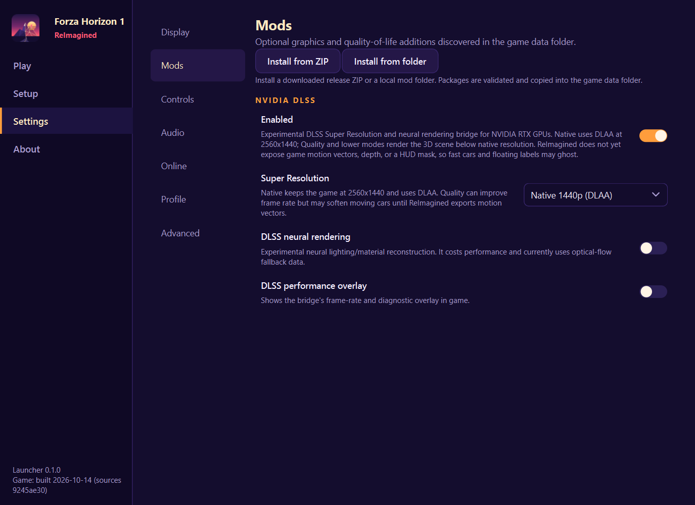

# NVIDIA DLSS for Forza Horizon 1: ReImagined

An experimental launcher mod that adds DLSS Super Resolution and optional neural rendering to
[Forza Horizon 1: ReImagined](https://github.com/Dyotson/ForzaHorizon1-ReImagined). It runs as a
process-local ReShade Vulkan layer; it does not register a system-wide layer or modify the game
runtime.



## Status

The bridge has initialized successfully on an RTX 5060 Ti at 2560x1440. DLSS Super Resolution
created its feature in Native/DLAA mode and processed frames. ReImagined does not yet export game
motion vectors, depth, camera jitter, or a HUD mask to the bridge. The optical-flow fallback works,
but moving cars and floating labels can blur or ghost. Native 1440p (DLAA) is therefore the default.

Frame generation is disabled. Neural rendering remains experimental and requires an additional
NVIDIA runtime that this repository does not distribute.

## Install

This repository contains the ReImagined manifest, configuration, source patch, and local packaging
tool. It deliberately excludes NVIDIA runtime DLLs and other third-party binaries.

1. Supply a local runtime folder containing these files:
   - `ReShade64.dll` and `ReShade64.json`
   - `standalone-dlssnr.addon64`
   - `nvngx.dll`
   - `nvngx_dlss.dll`
   - optionally `nvngx_dlssnr.dll` for neural rendering
2. Build a local install package:

   ```powershell
   .\tools\package-local.ps1 -RuntimeFolder C:\path\to\your\runtime
   ```

3. In the ReImagined launcher, open **Settings > Mods**, select **Install from ZIP**, and choose the
   generated archive in `dist`.

The ZIP is for local testing. Do not redistribute third-party binaries unless their applicable
licenses expressly permit your distribution.

## Presets

| Setting | Internal source | Purpose |
|---|---:|---|
| Native 1440p (DLAA) | 2560x1440 | Best current car and label clarity |
| Quality | 1920x1080 | Moderate performance target |
| Balanced | 1600x900 | Larger performance tradeoff |
| Performance | 1280x720 | Highest reconstruction load and most ghosting risk |

The launcher writes the chosen values to `ReShade.ini` immediately before starting the game.

## Source

`patches/0001-reimagined-vulkan-bridge.patch` records the local changes made on top of
[DLSS5 ReShade AIO 2.2.4](https://github.com/kibblerz/DLSS5-Reshade-AIO). The add-on is Apache-2.0;
its `LICENSE`, `NOTICE`, and third-party notices are included here. ReShade and NVIDIA software keep
their own licenses and are not relicensed by this repository.
